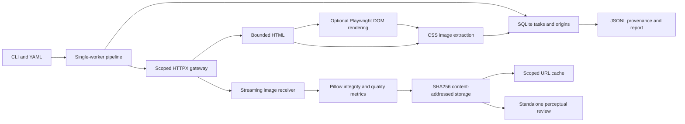
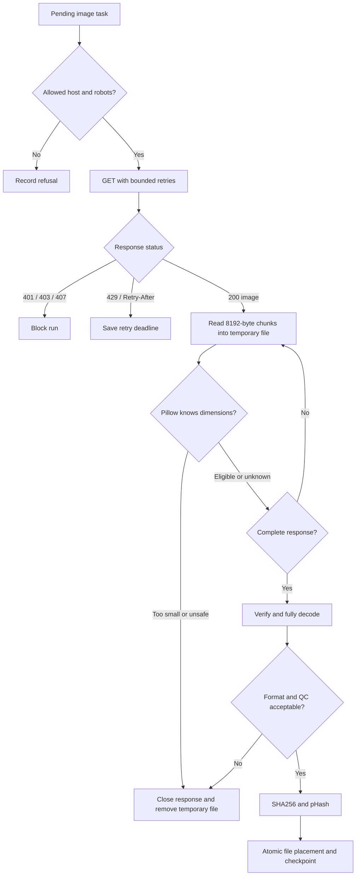

# PixelHarvest

A configurable Python toolkit for web image acquisition, streaming validation, quality assessment, perceptual deduplication, and resumable batch processing.

PixelHarvest is a **single-worker toolkit** extracted from a working downloader. Configure authorized domains, discover image URLs, reject undersized images while receiving their bodies, validate complete files, and resume interrupted batches. No website-specific adapters, API integrations, account data, or image collections are included.

> Publication staging: the owner must confirm the right to release the extracted code and approve a license. `LICENSE-MIT.proposed` is a proposal, not an effective license grant. See [release review](docs/RELEASE_REVIEW.md).

## Key features

- Plain HTTP discovery or optional Playwright DOM rendering through the same HTTPX policy gateway.
- CSS selectors, relative URL resolution, lazy image attributes and descriptor-based `srcset` selection.
- Streaming Pillow header parsing: actual width and height determine early rejection; file bytes and advertised HTML sizes do not determine pixel dimensions.
- Full verification and decoding, format allowlist, file/pixel limits, and atomic content-addressed files.
- Advisory FFT, Laplacian, aspect, white-page and possible upscaling assessments.
- Automatic SHA256 storage deduplication; standalone perceptual duplicate review with aspect checks and retention recommendations.
- SQLite checkpoints, cached pages/images, bounded retries, terminal percentage progress, JSONL provenance and JSON reports.
- Independent page/image cookie jars, explicitly scoped authentication and environment-backed proxy settings.
- Dependency injection, MockTransport tests, local HTTP/browser tests, and a synthetic measured benchmark.

## Installation

Python **3.12 or later** is required; the supplied locks and CI target Python 3.12 on Windows and Linux. Installation retrieves packages; the demo itself contacts only a loopback server.

```bash
python -m venv .venv
# Linux/macOS:
source .venv/bin/activate
# PowerShell instead: .venv\Scripts\Activate.ps1
python -m pip install --require-hashes -r requirements-dev.lock
python -m pip install --no-deps --no-build-isolation -e .
```

For a smaller HTTP-only environment, use `python -m pip install -e .`. Optional rendering dependencies: `python -m pip install -e ".[browser]"`, then `python -m playwright install chromium`. The development lock includes browser tooling and build tools; the runtime lock includes the browser extra but excludes test/build tools. Locks contain exact versions and artifact hashes. A downloaded browser is version-managed by Playwright and is not covered by the Python artifact lock.

Prefer a project-specific browser cache before installing browsers:

```bash
# Linux/macOS; PowerShell: $env:PLAYWRIGHT_BROWSERS_PATH="$PWD/.pixelharvest/browsers"
export PLAYWRIGHT_BROWSERS_PATH="$PWD/.pixelharvest/browsers"
python -m playwright install chromium
```

## Quick start: local demo

From the repository root, with the environment activated:

```bash
python -m examples.demo
```

The demo generates deterministic RGB textures in memory, starts a loopback HTTP server, crawls one gallery, downloads two identical eligible URLs into **one SHA256 file**, and rejects a small image during reception. It asserts the results and prints progress/report locations. No credentials or public website are needed. Generated artifacts remain in ignored `.pixelharvest/demo/`.

```bash
python -m examples.demo --browser
```

For your own authorized source, copy `config.example.yaml` to a private configuration file and change its URL/domain allowlists. Then:

```bash
pixelharvest crawl --config config.yaml --run-id gallery-001
pixelharvest report --workspace .pixelharvest --run-id gallery-001
```

`workspace` and cookie paths in YAML resolve relative to that YAML file. Pass that resolved workspace to `resume` and `report` if it differs from the default.

## CLI usage

| Command | Purpose |
| --- | --- |
| `pixelharvest crawl --config config.yaml --run-id example` | Discover images from configured page URLs. Optional `--input pages.txt` or CSV overrides the configured list. |
| `pixelharvest download --config config.yaml --input urls.csv --run-id example` | Download already known image URLs; no page request is necessary. |
| `pixelharvest resume --workspace .pixelharvest --run-id example` | Continue unfinished tasks without repeating successful tasks. |
| `pixelharvest resume --workspace .pixelharvest --run-id example --retry-failed` | Also retry ordinary failed tasks; does not override blocked runs or server retry deadlines. |
| `pixelharvest inspect --config config.yaml --input ./images --output .pixelharvest/inspection.json` | Validate images and export quality results. |
| `pixelharvest dedup --config config.yaml --input ./images --output .pixelharvest/duplicates.json` | Report exact/near duplicates and recommended retention; does not delete files. |
| `pixelharvest report --workspace .pixelharvest --run-id example` | Regenerate metadata and the summary from checkpoints without network requests. |

Global `--verbose` precedes the command. Progress is logged to the terminal as `[ 33.33%] image 1/3`. Page and image percentages are separate because discovering pages can increase the image count. Exit codes: `0` processed without ordinary failures (rejections can be expected), `2` failed/blocked/deferred/configuration error, `130` interrupted. A `complete` run can contain failed tasks; inspect its counts.

### Input and output

Text input contains one complete URL per line; comments begin with `#`. CSV input uses a `url` or `image_url` column and standard quoting:

```csv
url,title,source_url
"https://example.org/assets/texture.jpg?crop=1,2","Texture, sample",https://example.org/gallery
```

URL query strings are preserved for actual requests, including commas and signed parameters. Fragments are removed. There is no CDN-specific rewriting, guessed high-resolution URL, quality override, or attempt to recover an unavailable original.

```text
.pixelharvest/
  state.sqlite3                 # private original URLs and run config
  .worker.lock                  # one active worker per workspace
  pages/<cache-key>.html        # private authenticated page cache
  pages/<cache-key>.json
  images/<sha-prefix>/<sha>.jpg  # extension from decoded format
  tmp/<run-id>/<task-id>.part
  runs/<run-id>/metadata.jsonl
  runs/<run-id>/report.json
```

Metadata includes image status, relative image path, SHA256/pHash, actual dimensions, received bytes, when dimensions became known, quality metrics/flags, and source page URL/title/alt/caption. Multiple source pages remain associated with one image URL. Reports omit credentials, strip query strings from displayed image/page URLs, and whitelist selected response headers. Full URLs remain in the private database for reproducible requests. **Content and URL paths can themselves be sensitive; review any report before sharing.** These are generic acquisition records, with no publisher-specific delivery classification.

## Configuration

[config.example.yaml](config.example.yaml) documents every setting through an executable complete example; unknown keys fail validation. Its only external host is the reserved `example.org`. Important groups:

| Group | Controls |
| --- | --- |
| `urls`, `allowed_domains`, `image_domains`, `selectors` | Explicit page/image hosts and CSS extraction scope. Hostnames are exact, without ports or wildcards; an allowed host includes its ports. |
| `workspace`, `batch_size` | Output/checkpoint directory and number of queued tasks loaded at once. Batch size is not concurrency. |
| `page` | `http` or `browser`, document-only or rendered DOM, optional installed browser channel, rendering wait, maximum HTML/resource bytes. |
| `http` | Identifiable User-Agent, 3-second request spacing per transport, timeout, redirect count, attempt cap, exponential backoff, robots policy, maximum file bytes, `proxy_env`. |
| `page_auth`, `image_auth` | Independent cookie files, explicit authentication domains, static public headers and environment variable names for private headers. |
| `quality` | Minimum width/height/short side, pixel cap, format allowlist, aspect policy and optional heuristic thresholds. |
| `dedup` | pHash distance, aspect tolerance, `first` or quality-based `best` recommendation. |

Defaults require width and height of at least 1024 pixels, at most 40 million pixels, at most 50 MiB per image, and JPEG/PNG/WebP/AVIF. AVIF availability depends on the installed Pillow build. Blank-image rejection and advisory heuristics are enabled; set `heuristics: false` to retain legitimate blank artwork. Aspect ratio is advisory unless `reject_extreme_aspect: true`.

### Authentication and proxy

Cookies may be a Netscape cookie file or a JSON **list** of browser-exported cookie objects with `name`, `value`, `domain`, optional `path`, `secure` and Unix `expires`. Negative/null expiry means a session cookie. No browser profile, `.env` file or browser login is imported automatically.

```yaml
page_auth:
  cookie_file: private/cookies.json
  allowed_domains: [example.org]
  headers_env:
    Authorization: PIXELHARVEST_AUTHORIZATION
image_auth:
  cookie_file: null
  allowed_domains: []
http:
  proxy_env: PIXELHARVEST_PROXY
```

Set referenced environment variables outside the repository. `.env.example` is explanatory and is never automatically loaded. `headers_env` values are complete header values, including any required authentication scheme. Static `headers` are for public values only. Cookies and private headers are sent only to their explicit auth hosts; redirects are checked again. New session cookies from authorized responses are retained in memory, not written to the cookie file. Images inherit **none** of the page cookies or private headers. Standard proxy authentication is supplied through the proxy URL in the named environment variable, and `trust_env=False` prevents accidental system proxy inheritance. A configured proxy is shared by page and image transports; use a separate workspace/config on another machine for a separate download stage.

HTTP `401`, `403`, and `407` block the run. `429`, and `5xx` with valid `Retry-After`, defer it until the stored deadline. A blocked run requires investigation and a deliberately new run after access is legitimately resolved; the CLI does not bypass the block. Robots restrictions are checked and cached separately per transport/origin. Robots request failures or redirects are handled conservatively. There is no proxy rotation, identity spoofing, CAPTCHA solving, or access-control bypass.

## Architecture



Both plain and browser modes use the same HTTPX request policy. Playwright receives the canonical fetched document; its allowed GET resources are fulfilled through that gateway. Native browser redirects cannot skip host/auth checks. Images, fonts, media, frames, service workers, WebSockets and non-GET browser requests are blocked. Rendered mode can run scripts and issue additional permitted requests; document mode avoids those resources. This design supports DOM rendering and standard sessions, not browser fingerprint emulation or pages that require browser-native networking.

## Streaming validation



Header dimensions are usually available in the first 8192 application bytes for JPEG/PNG, but this is format/content dependent. Unknown dimensions fall back to full decoding. Early rejection closes the response; underlying socket/server buffering can already have transferred more bytes. Every accepted image completes verification and decoding. HTTP failures, non-image MIME types, oversized files, corrupt/truncated images and disallowed formats do not become delivered files. Temporary files are cleaned on normal failure/interruption and when recovering a terminated process. Downloads restart at the image boundary; byte-range resume is not implemented.

## Image quality assessment

Pillow verification and a second full decode protect integrity. Explicit pixel limits and decompression-bomb checks apply before image loading. Quality reports provide:

- Actual dimensions, format, mode, ICC presence and file size.
- FFT high-frequency energy ratio and Laplacian variance on a grayscale sample.
- Advisory `suspect_upscaled`, `possibly_blurry`, aspect, white-page and color-mode flags.

Heuristics vary with subject matter and resizing. They **cannot establish native resolution**, originality, ownership or artistic value. `review` images are retained for human assessment; integrity/size/format failures and configured hard constraints reject files. The tool does not call AI services or infer an image's creation category from an article title.

## Deduplication

SHA256 is integrated into the download pipeline: identical decoded-file bytes occupy one content-addressed path while source associations remain. A repeated URL with the same authenticated cache scope can avoid another GET; different URLs must be received before exact content equality is known.

Perceptual matching is a **standalone review command**, not an automatic download-time deletion step. It compares 64-bit pHash distance and relative aspect-ratio difference. `best` ranks possible-upscaling flags, pixel area, blur flags, heuristic status and format, with a deterministic path-order tie break. Reports recommend retention and leave files untouched. Re-encodes/resizes can match; crops, rotations and different scenes may be missed or falsely matched. Pairwise comparison is O(n?), appropriate for reviewed batches rather than very large libraries.

## Batch recovery

Tasks are committed as pending ? in progress ? done/rejected/failed, with blocked/deferred states for access/rate responses. On restart, unfinished in-progress tasks return to pending; complete files/tasks are reused. The workspace lock prevents two active execution workers. Do not submit, report, or edit the same workspace concurrently with its active worker.

Page cache keys include original URL, authentication material hashed into the key, and rendering settings. Image cache keys include URL/auth scope. Cached files are verified against SHA256 before reuse; quality is rechecked against current thresholds for a new run. There is no automatic cache expiry/revalidation, so use a new workspace for fresh source content. The SQLite database, cached HTML, cookie files and output metadata are private operational data, not repository assets.

## Benchmark results

Measured on Python 3.12.2 / Windows AMD64 / HTTPX 0.28.1 / Pillow 13.0.0, using a real loopback HTTP server and eight seeded random RGB JPEGs, with no padding. Six 4096?512 images fail the 1024?1024 minimum; two 1600?1200 images pass.

| Method | Body bytes consumed | Rejected | Elapsed seconds |
| --- | ---: | ---: | ---: |
| Full download, then dimensions | 14,725,353 | 6 | 0.480957 |
| Streaming dimension rejection | 3,491,723 | 6 | 0.300010 |

Measured application body bytes saved: **11,233,630 (76.288%)**. The dataset deliberately favors early geometry rejection. This is one local run, not a general speed/bandwidth guarantee. Socket read-ahead, protocol overhead, network distance, image layout and dataset mix change outcomes. FFT/pHash/extended QC are excluded from both timings. Raw measurements, including server write observations, are in [benchmarks/results.json](benchmarks/results.json).

```bash
python -m benchmarks.streaming --output .pixelharvest/benchmark.json
```

## Testing

```bash
python -m ruff check src tests examples benchmarks scripts
python -m ruff format --check src tests examples benchmarks scripts
python -m pytest -m "not integration" -q
python -m pytest -m integration -q
# Enable real Chromium tests after installing it:
# PowerShell: $env:PIXELHARVEST_BROWSER_TESTS="1"
PIXELHARVEST_BROWSER_TESTS=1 python -m pytest -m integration -q
python scripts/scan_secrets.py
python -m build --no-isolation
```

Tests generate their own images/HTML and use MockTransport or loopback HTTP. They cover scoped sessions, authentication-free image downloads, redirects, robots, server halt/defer behavior, streaming rejection, corruption, pixel/format limits, quality metrics, exact/perceptual duplicate reports, cache integrity, provenance, batch interruption and recovery. Browser tests are optional locally; CI explicitly installs Chromium and enables them on Linux and Windows. CI is configured but has not run on GitHub before the first push.

## Security and responsible usage

Use only sources and credentials you are authorized to access; respect source terms, robots and rate limits. Authorization to view content does not grant permission to redistribute it. Read [SECURITY.md](SECURITY.md) before sharing files. No credentials, original HTML, browser profiles, images, customer configurations or source database are included.

The publication scanner examines tracked files for common secret patterns, credential URLs, private keys, hardcoded IPs, personal paths and runtime artifacts. It intentionally fails on tracked binary files. It is a bounded rule-based check, not a guarantee of absence of secrets. Review the staged diff and publication manifest manually too. Dependency metadata is inventoried in [docs/dependency-licenses.json](docs/dependency-licenses.json); dependencies and separately installed browser binaries retain their own licenses. No third-party implementation source is vendored.

## Limitations

- One active worker per workspace; no distributed scheduling, shared-state VM coordination, concurrency framework or queue service.
- Exact host allowlists include all ports; they are not a network firewall or DNS-rebinding defense. Do not expose the CLI as an untrusted URL execution service.
- Fixed DOM wait and CSS selectors do not expand every interactive gallery, scroll indefinitely, extract all CSS backgrounds or interpret proprietary hydration formats.
- Browser resources use HTTPX; non-GET flows, browser-native networking requirements and browser fingerprint emulation are unsupported. JavaScript is opt-in and should run only against trusted authorized pages.
- No automatic original-size URL guessing, byte-range recovery, cache freshness policy, AI classification or verified-native-resolution claim.
- Pillow safety limits bound decoded pixels but do not sandbox decoder CPU/memory; isolate untrusted workloads at the operating-system level.
- Perceptual deduplication is advisory and quadratic; formats/codecs depend on the Pillow build.
- Reports can contain source-authored text and URL paths. The private workspace is not a publishable debug bundle.

## Roadmap

Potential follow-up work: explicit cache expiry/revalidation, structured adapter contracts for additional authorized sources, streamed discovery/download manifest exchange, more bounded gallery policies, and indexed perceptual candidate search. None is claimed as implemented distributed infrastructure.

## License and release status

The GitHub remote is supplied by the owner; the Python/project name remains PixelHarvest. Only a local initial commit is prepared until the owner confirms publication rights and the proposed MIT license. See [the release review and exact file manifest](docs/RELEASE_REVIEW.md). No package release or public push has been performed during staging.
