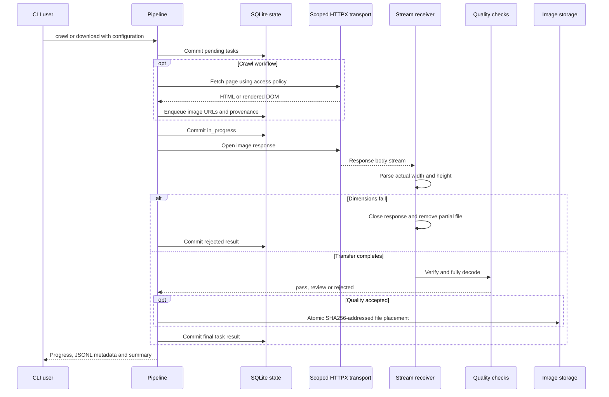

# PixelHarvest: Technical and Operations Guide

This guide explains the implemented acquisition pipeline, configuration, metadata, recovery behavior and extension points. Read the [README](../README.md) for a shorter introduction.

## Contents

1. Purpose and scope
2. Architecture and module responsibilities
3. Installation on Windows and Linux
4. Run the synthetic local demo
5. Configure an authorized source
6. Choose the correct workflow
7. Understand URL discovery
8. Understand streaming size decisions
9. Configure sessions and proxies
10. Interpret quality assessment
11. Exact and perceptual deduplication
12. Read metadata and reports
13. Recover interrupted batches
14. Investigate failures
15. Reproduce the benchmark
16. Develop and test changes
17. Change sources or separate acquisition stages
18. License, security and publication

## 1. Purpose and scope

PixelHarvest takes page URLs or image URLs and produces verified image files with provenance and durable checkpoints. Its priorities are predictable network behavior, useful rejection diagnostics, and recovery without repeating completed work.

Two workflows are available:

- **Crawl:** fetch supplied pages, extract candidate image URLs, then download and validate the discovered images.
- **Download:** receive known image URLs, then download and validate them without fetching their source pages.

The toolkit does not discover a publication's complete archive automatically. No article-list API is integrated. Downloading an image URL does not require an API call, but HTTP requests to the page/image hosts still occur. An API quota and a website's access/rate policies are separate concerns.

This is a single worker with a local SQLite workspace. It is not a distributed crawler, browser identity emulator, content-rights verifier or AI classifier.

## 2. Architecture and module responsibilities

Core modules live in `src/pixelharvest/`:

| Module | Responsibility |
| --- | --- |
| `cli.py` | Parse commands, configure logging and return exit codes. |
| `config.py` | Merge YAML/defaults, validate keys/scopes/limits and resolve paths. |
| `pipeline.py` | Execute tasks, coordinate cache/QC/storage, checkpoint and report. |
| `transport.py` | HTTPX requests, domain checks, robots, spacing, redirects and status handling. |
| `auth.py` | Scoped cookies and environment-backed headers; displayed URL redaction. |
| `page_fetchers.py` | Optional Playwright rendering through the shared HTTPX policy gateway. |
| `parser.py` | CSS-based discovery and generic URL resolution. |
| `downloader.py` | Stream image bodies and reject known invalid dimensions early. |
| `image_qc.py` | Verify/decode images, enforce constraints and calculate advisory metrics. |
| `dedup.py` | Exact/perceptual hashes and duplicate retention recommendations. |
| `cache.py` | Scoped URL lookup and content-addressed file storage. |
| `state.py` | SQLite schema, durable task state and workspace execution lock. |

`__init__.py` defines the package version; `__main__.py` supports `python -m pixelharvest`.



HTTPX remains the download engine. Playwright is an optional DOM renderer rather than an independent downloading implementation.

## 3. Installation on Windows and Linux

Python 3.12 is the development/CI baseline. Package metadata permits later Python versions, but the supplied dependency locks and recorded validation specifically target 3.12.

```bash
git clone https://github.com/Williamlaiwei/pixelharvevst.git
cd pixelharvevst
```

### Windows PowerShell

Activation is optional. Calling executables directly avoids changing shell activation policy:

```powershell
py -3.12 -m venv .venv
.venv/Scripts/python.exe -m pip install --require-hashes -r requirements-dev.lock
.venv/Scripts/python.exe -m pip install --no-deps --no-build-isolation -e .
.venv/Scripts/pixelharvest.exe --help
```

### Linux or macOS

```bash
python3.12 -m venv .venv
source .venv/bin/activate
python -m pip install --require-hashes -r requirements-dev.lock
python -m pip install --no-deps --no-build-isolation -e .
pixelharvest --help
```

The development lock includes test/build tools and the browser extra. The runtime lock includes the browser extra but excludes development tooling. For an HTTP-only environment with normal dependency resolution, use `python -m pip install -e .`.

### Optional Chromium installation

Prefer a project-specific browser cache:

```powershell
$env:PLAYWRIGHT_BROWSERS_PATH="$PWD/.pixelharvest/browsers"
.venv/Scripts/python.exe -m playwright install chromium
```

```bash
export PLAYWRIGHT_BROWSERS_PATH="$PWD/.pixelharvest/browsers"
python -m playwright install chromium
```

Use the same `PLAYWRIGHT_BROWSERS_PATH` for later browser runs. Browser binaries are separate distributions, outside the Python hash lock. CI installs Chromium with `playwright install --with-deps chromium` to supply Linux system dependencies too.

## 4. Run the synthetic local demo

From the repository root, in the environment:

```bash
python -m examples.demo
python -m examples.demo --browser
```

The demo generates images in memory and starts a temporary loopback HTTP server. No public website or credentials are required. It exercises parsing, transfer, dimension rejection, QC, SHA256 storage and metadata reporting.

Expected results are one completed page, two completed eligible image tasks with identical bytes, and one rejected small image. The summary is `done: 3`, `rejected: 1`, `unique_files: 1`; the page contributes one of the three completed tasks. A new run ID is generated each invocation and actual report paths are printed. Generated data stays in ignored `.pixelharvest/demo/`.

The browser demo uses document mode; integration tests additionally cover JavaScript-generated image elements in rendered mode.

## 5. Configure an authorized source

Copy `config.example.yaml` into a private ignored directory, such as `.pixelharvest/private/config.yaml`. Reserved example hosts below are placeholders rather than working image feeds.

```yaml
workspace: ../work
urls:
  - https://example.org/gallery
allowed_domains:
  - example.org
image_domains:
  - example.org
selectors:
  - main img
quality:
  min_width: 1024
  min_height: 1024
http:
  request_interval_seconds: 3
  respect_robots: true
```

With that file location, the workspace resolves to `.pixelharvest/work`. Workspace/cookie paths resolve against the YAML directory. Relative CLI `--input` and `--output` paths resolve against the process working directory.

`allowed_domains` controls page requests; `image_domains` controls image requests. Use exact hostnames without schemes, ports, paths or wildcards. Different page and image hosts must appear in their corresponding lists. Authentication domains must be a subset of that transport's allowed hosts.

A hostname allowlist includes its ports. It is not a firewall, DNS-rebinding defense, or safe endpoint for arbitrary untrusted URL submissions.

| Setting | Default | Meaning |
| --- | ---: | --- |
| `quality.min_width` | 1024 | Minimum decoded width, pixels. |
| `quality.min_height` | 1024 | Minimum decoded height, pixels. |
| `quality.min_short_side` | 0 | Additional shorter-side constraint; zero disables it. |
| `quality.max_pixels` | 40,000,000 | Maximum width multiplied by height before loading. |
| `http.max_file_bytes` | 52,428,800 | Maximum image response size, 50 MiB. |
| `page.max_html_bytes` | 5,000,000 | HTML/per-resource limit in the browser gateway. |
| `http.request_interval_seconds` | 3 | Request-start spacing within a transport. |
| `http.timeout_seconds` | 20 | HTTPX timeout; not a whole-job deadline. |
| `http.max_attempts` | 2 | Eligible transient retry attempt cap. |
| `http.max_redirects` | 3 | Maximum followed HTTP redirects. |
| `batch_size` | 100 | Task rows loaded per scheduling batch, not concurrency. |

Page/image transports maintain independent spacing and robots caches. There is no global quota controller across multiple processes or machines.

## 6. Choose the correct workflow

### Crawl page URLs

```bash
pixelharvest crawl --config .pixelharvest/private/config.yaml --run-id gallery-001
pixelharvest crawl --config .pixelharvest/private/config.yaml --input pages.txt --run-id gallery-002
```

`--input` overrides configured URLs and accepts text or CSV. Run IDs allow letters, digits, underscores and hyphens. If omitted for a new run, a short random ID is generated. Explicit IDs are easier to resume/audit.

### Download image URLs directly

```bash
pixelharvest download --config .pixelharvest/private/config.yaml --input image-urls.csv --run-id images-001
```

This skips page retrieval. It still performs image requests, applicable robots checks and validation. Use it when another authorized process has already selected the correct image URLs.

Text input uses one complete URL per line; blank lines and comments beginning with `#` are ignored. CSV requires `url` or `image_url` and normal CSV quoting:

```csv
url,title,source_url
"https://example.org/assets/texture.jpg?crop=1,2","Generated texture, example",https://example.org/gallery
```

Do not split rows on commas manually: query strings and titles can contain commas. CSV can carry provenance. The generic exported source fields are `source_url`, `title`, `alt` and `caption`; arbitrary extra columns are not promised in the public metadata projection.

### Inspect local images

```bash
pixelharvest inspect --config .pixelharvest/private/config.yaml --input ./images --output .pixelharvest/inspection.json
pixelharvest dedup --config .pixelharvest/private/config.yaml --input ./images --output .pixelharvest/duplicates.json
```

These commands make no page/image requests. They still use validated configuration, including required domain lists. Directory extension filters cover JPEG, PNG, WebP and AVIF; a single file can also be supplied.

## 7. Understand URL discovery

BeautifulSoup/lxml selects elements using CSS. The parser examines `src`, `data-src`, `srcset` and `data-srcset`; selected `img` elements can also use enclosing `picture` source candidates. Descriptor selection prefers a larger width, or a larger density when width descriptors are unavailable.

Declared HTML widths are hints only. Actual size eligibility comes from image bytes. Relative paths resolve against the final fetched page URL, query strings including commas remain unchanged, and fragments are removed. Non-HTTP(S) schemes and embedded URL user information are rejected.

This simple policy does not emulate every picture/media/type decision, expand interactive galleries, scroll infinite lists, inspect every CSS background or decode proprietary hydration structures. A selected URL can still be a thumbnail if that is all the markup exposes.

Narrow selectors to the relevant gallery/article container. Broad selectors can include logos, avatars and recommendations, increasing requests before size rejection. If static HTML lacks the image element, consider rendered mode when authorized:

```yaml
page:
  renderer: browser
  render_mode: rendered
  render_wait_ms: 1000
```

HTTP is the default renderer. Browser document mode disables JavaScript and non-document resources. Rendered mode permits scripts and supported allowed GET resources, while blocking images/fonts/media, child documents, service workers, WebSockets and non-GET browser requests.

Playwright receives the HTTPX-fetched document and supported requests are fulfilled through the same gateway. This prevents a browser-native redirect from bypassing the HTTP policy and prevents independent browser image downloads. It does not emulate Chrome's native network fingerprint or every browser-only login flow.

## 8. Understand streaming size decisions

### Pixels are different from encoded bytes

Dimensions describe decoded geometry. File size depends on dimensions, content, codec and encoding parameters. Two 1600-by-1200 files can have very different byte sizes. Higher JPEG encoding quality changes bytes/artifacts; it does not automatically increase dimensions or recover missing detail.

PixelHarvest preserves supplied query parameters. It does not guess alternate original URLs or modify a CDN's quality/format settings.

### Earliest reliable decision

The receiver starts a streaming GET, checks status/MIME/advertised size, then reads 8192-byte application chunks into a temporary file. Pillow's incremental parser observes those bytes. Once it recognizes the header, actual width/height become available.

If width, height or shorter-side constraints fail, reception stops and the temporary file is removed. Unsafe pixel counts are rejected before full decoding. Many JPEG/PNG headers are recognized in the first chunk, but not every image/codec behaves that way. Unknown dimensions fall back to full reception and decoding.

There is no preliminary HEAD request per image. `Content-Length` describes encoded bytes, not pixel dimensions. Fetching an arbitrary HTML `head` section is not a reliable generic method for locating all article/gallery images either.

### Checks before storage

The receiver rejects non-image MIME types, oversized responses, detected incomplete unencoded responses and invalid files. Accepted transfers undergo Pillow `verify()` followed by a second open and full `load()`. Format allowlists apply to the decoded format; the stored extension follows that format rather than the URL suffix.

Full QC follows reception. A transferred image can still fail QC, so metadata separates `transfer_status` from final task `status`.

Early closing limits application-consumed bytes. Server/socket buffers can already have transferred more. Recorded body bytes are not exact wire traffic or billing measurements.

## 9. Configure sessions and proxies

### Separate page and image authentication

```yaml
page_auth:
  cookie_file: cookies.json
  allowed_domains: [example.org]
  headers_env:
    Authorization: PIXELHARVEST_AUTHORIZATION
image_auth:
  cookie_file: null
  allowed_domains: []
```

Cookie paths resolve against YAML. Images inherit no page cookies/private headers. If an image host independently requires an authorized session, explicitly configure its own `image_auth` scope.

Cookie formats are Netscape files or JSON lists of objects with `name`, `value`, `domain`, optional `path`, `secure` and Unix `expires`. Negative/null/missing JSON expiry means a session cookie. Secure cookies require HTTPS. No personal browser profile is imported automatically.

Private header values come from named environment variables. Include any required authorization scheme in the full value. Static `headers` are for public values. `.env.example` is explanatory: no `.env` file is automatically loaded.

Authorized server-issued cookies remain in memory during the process, without modifying the input cookie file. After restart, auth is loaded from the original cookie file/current environment. Refresh these legitimately when the source session expires or changes.

### Explicit proxy setting

```yaml
http:
  proxy_env: PIXELHARVEST_PROXY
```

Set the variable outside Git. A non-authenticated illustrative endpoint is `http://proxy.example.org:8080`; real endpoints/credentials belong only in the private environment. Page and image transports share the configured proxy. Missing/invalid configured values fail rather than falling back to direct access. HTTPX `trust_env=False` prevents unrelated system proxy inheritance.

The toolkit does not rotate proxies or change identity after access denial. Authentication, rate policy and content redistribution rights are separate requirements.

## 10. Interpret quality assessment

| `quality.status` | Meaning | New accepted image stored? |
| --- | --- | --- |
| `pass` | Hard constraints pass without advisory flags. | Yes |
| `review` | Hard constraints pass, with heuristic concerns for review. | Yes |
| `rejected` | Integrity, size, format, pixel/aspect constraints or blank-image rule fail. | No |

Quality records contain dimensions, format, mode, file size, ICC presence, reasons, flags, source-quality assessment and metrics. FFT high-frequency energy and Laplacian variance use a grayscale sample. Low frequency energy may suggest upscaling; low Laplacian variance may suggest blur. White-page/border, aspect and unusual color-mode flags provide additional context.

These are not creation-type labels, proof of native resolution or ownership evidence. Smooth illustration, shallow depth of field, low-light photography and compression can produce misleading values. Calibrate thresholds with reviewed representative samples.

Aspect ratio is advisory unless `reject_extreme_aspect: true`. With heuristics enabled, essentially uniform images are rejected as blank. Set `heuristics: false` when blank/minimal artwork is legitimate; integrity/format/dimension safety checks still apply.

## 11. Exact and perceptual deduplication

### Integrated exact storage deduplication

SHA256 is computed over complete file bytes. Identical bytes use one destination:

```text
images/<first-two-digest-characters>/<sha256>.<decoded-extension>
```

Different URLs can reference the same destination while retaining separate task/provenance records. Each distinct URL must be received before its bytes are known. A verified scoped URL-cache hit can avoid a later GET for the same URL/auth context.

Visually identical re-encoded images can have different SHA256 values because their bytes differ.

### Standalone perceptual review

```yaml
dedup:
  phash_threshold: 8
  aspect_tolerance: 0.02
  keep: best
```

The standalone `dedup` command compares 64-bit pHash distance and relative aspect ratio. Lower distance thresholds are stricter. `best` ranks possible-upscaling flags, pixel area, blur flags, heuristic status and format, then breaks ties deterministically. `first` uses sorted path order.

Reports recommend retention but delete no files. Pairwise recommendations do not constitute automatic perceptual clustering in the download pipeline. Re-encodes/resizes may match; crops/rotations can be missed, and unrelated images can collide. Manually review results. Comparison is O(n?), suited to reviewed batches rather than an unbounded library.

## 12. Read metadata and reports

Each run exports:

```text
<workspace>/runs/<run-id>/metadata.jsonl
<workspace>/runs/<run-id>/report.json
```

### JSONL schema

Each line describes an image task. Fields depend on processing progress; pending/early-rejected tasks do not contain every successful-transfer field.

| Field | Interpretation |
| --- | --- |
| `image_url` | Display URL with query/fragment/user information removed. Full request URLs stay in private SQLite. |
| `status` | Durable task state: `done`, `rejected`, `failed`, `pending`, `blocked`, `deferred`, or an in-progress state. |
| `transfer_status` | Receiver status such as `downloaded`, `skipped_actual_dimensions` or `failed`; null without a recorded receiver result. |
| `sources` | Source page URL/title/alt/caption projected from discovery or supplied CSV provenance. |
| `file_path` | Workspace-relative content-addressed path when a stored/cache file is referenced. |
| `actual_width`, `actual_height` | Dimensions discovered during reception/final decoding, when available. |
| `dimension_known_at_bytes` | Application body bytes consumed when dimensions were first recorded. |
| `bytes_received` | Recorded task-result image body consumption; zero for URL-cache reuse. |
| `attempts` | Receiver attempts within that download invocation, when available. |
| `http_status`, `response_headers` | HTTP outcome and selected non-cookie headers when recorded. |
| `sha256`, `phash` | Exact/perceptual hashes, when computed. |
| `cache_hit` | Whether a verified scoped URL-cache entry was reused. |
| `quality` | Full QC record when that stage was reached. |
| `reason` | Rejection/failure diagnostic, when provided. |

A fully transferred blank image can have `transfer_status: downloaded`, `status: rejected`, and `quality.status: rejected`. Transfer completion and acceptance are separate decisions.

The JSON summary includes `run_id`, run `status`, task total, counts by task state, recorded image bytes, unique referenced stored files and metadata path. Crawl task counts include pages; JSONL records contain images only. `complete` means queued work was processed, not that every task succeeded.

Byte totals are operational summaries, not cumulative network accounting across every interruption or failed-task rerun. An exception before a task result is stored can leave no byte total. Prior header-size evidence may remain visible on a cache result with zero new bytes.

New runs recheck cached files with current QC settings. A file rejected by new thresholds may remain on disk from a previous accepted run. A referenced path alone is not proof of acceptance in the current run.

### Privacy and original URL recovery

Queries are stripped because signed access parameters can be private. Full URLs remain in SQLite for reproducible resume. Source text, URL paths, headers and local output paths can still be sensitive: reports are not automatically publishable debug bundles.

For authorized provenance audits, use the private database locally or retain the original private URL manifest. A redacted display URL cannot reconstruct a signed request URL reliably.

## 13. Recover interrupted batches

Tasks are committed before work starts and after outcomes are known. Normal interruption saves a run report where possible. Restart also recovers stale `in_progress` tasks left after abrupt termination.

```bash
pixelharvest resume --workspace .pixelharvest/work --run-id gallery-001
pixelharvest report --workspace .pixelharvest/work --run-id gallery-001
pixelharvest resume --workspace .pixelharvest/work --run-id gallery-001 --retry-failed
```

Resume loads saved run configuration. To change source settings, thresholds or rendering deliberately, create a new run. Reusing a run ID with different configuration fails validation.

Completed tasks are not fetched again. Interrupted image transfers restart at the image boundary; no HTTP Range resume is implemented. Temporary files are cleaned and accepted files use atomic rename within the workspace filesystem. Reports use temporary-file replacement. These measures address process recovery, not every possible storage/power failure.

Only one execution worker can hold a workspace lock. Do not submit tasks, modify SQLite or regenerate reports concurrently against its workspace. Preserve the whole workspace for continuation; saved configuration contains resolved paths, which must be considered before moving it.

### Cache scope and freshness

Page keys hash URL, current auth material and rendering settings. Image keys hash URL/auth material. Saved SHA256 checks detect local cache changes. Entries have no TTL or automatic conditional revalidation; use a fresh workspace for updated remote content.

New session-cookie values can change cache scope. Neither unchanged credentials nor matching cache keys establish source freshness.

### Server status policy

| Response | Behavior |
| --- | --- |
| `401`, `403`, `407` | Block run; no repeated automatic access attempts. |
| `429` | Defer to a stored retry deadline, using a configured default when needed. |
| `5xx` with valid `Retry-After` | Defer until that deadline. |
| Eligible transient network/`5xx` failure | Bounded exponential backoff in the receiver/plain-HTTP page path. |
| Robots refusal or prohibited redirect | Refuse without requesting the prohibited destination. |

Browser resource failures do not promise identical per-resource retry behavior to the plain-HTTP page path. `--retry-failed` does not override a blocked run or an unexpired server deadline. Resolve legitimate access/session requirements first; start a deliberately new run only after access is resolved.

## 14. Investigate failures

| Symptom | Check | Appropriate next action |
| --- | --- | --- |
| No image tasks | Selectors, static versus dynamic DOM, image allowlist and actual markup. | Review one authorized page; correct scope or enable rendering if necessary. |
| Wrong variant | Selected srcset candidate/source element. | Correct extraction policy; a thumbnail filename is not proof of an available original. |
| Image too small | Actual dimensions and `dimension_known_at_bytes`. | Review requirements; encoding quality does not fix pixel dimensions. |
| `not_image_content_type` | Endpoint may return login/error HTML. | Confirm URL and legitimate image authorization. |
| Decode/incomplete-response failure | Truncation, corruption, transfer interruption or missing codec. | Diagnose first, then retry eligible failures. |
| Pixel/bomb rejection | Decoded width multiplied by height exceeds policy. | Keep limits conservative; isolate unusually large legitimate inputs. |
| Blocked `403` | Page/image task kind, exact host and auth scope in private records. | Stop and resolve access policy/session; do not rotate identity to bypass denial. |
| Deferred run | Stored retry deadline. | Resume after the deadline. |
| Cache integrity error | Cached file changed or storage was damaged. | Preserve evidence if needed and use a fresh workspace rather than trusting modified content. |
| Browser launch failure | Matching installation, channel and browser-cache variable. | Install the intended browser; prefer HTTP when sufficient. |
| CLI configuration error | Unknown keys, required lists, invalid values or missing environment variables. | Compare with example YAML; raw exception messages are suppressed to avoid credential leakage. |

Progress is per task kind. The image denominator can grow during page discovery. Expected rejections can coexist with successful completion; inspect task counts.

Exit codes: `0` processed without ordinary failures, `2` failure/blocked/deferred/configuration error, `130` interruption. Global verbose precedes the command: `pixelharvest --verbose crawl ...`. HTTPX/httpcore request logs remain suppressed to reduce query exposure.

## 15. Reproduce the benchmark

The benchmark uses a real loopback HTTP server and seeded random RGB JPEGs. Six 4096-by-512 images fail a 1024-by-1024 minimum; two 1600-by-1200 images pass. No padding is appended to exaggerate early rejection.

| Recorded measurement | Full download | Streaming rejection |
| --- | ---: | ---: |
| Application body bytes consumed | 14,725,353 | 3,491,723 |
| Rejected images | 6 | 6 |
| Elapsed seconds | 0.480957 | 0.300010 |

Body consumption falls by 11,233,630 bytes, or 76.288%, in that recorded run. The geometry-selective dataset is intentionally favorable to early rejection, not representative of a whole website. Server writes differ because of read-ahead/buffering. Protocol overhead and already-buffered traffic are not included in claimed body savings.

```bash
python -m benchmarks.streaming --output .pixelharvest/benchmark.json
```

One sequential round runs per method. Both check actual dimensions; accepted files verify/decode. Extended QC, FFT and pHash are excluded from both timings. CPU, OS scheduling, codec versions and dataset mix affect results. Read [raw measurements](../benchmarks/results.json) as one observation rather than a general speed guarantee.

## 16. Develop and test changes

Use the hashed development environment:

```bash
python -m ruff check src tests examples benchmarks scripts
python -m ruff format --check src tests examples benchmarks scripts
python -m pytest -m "not integration" -q
python -m pytest -m integration -q
python scripts/scan_secrets.py
python -m build --no-isolation
```

Enable actual Chromium tests after installing it:

```powershell
$env:PIXELHARVEST_BROWSER_TESTS="1"
.venv/Scripts/python.exe -m pytest -m integration -q
```

```bash
PIXELHARVEST_BROWSER_TESTS=1 python -m pytest -m integration -q
```

Fixtures generate their own HTML/images. MockTransport tests request decisions/body handling; a local HTTP server tests real HTTP integration; Chromium tests rendering, safe redirect refusal and page-auth/image isolation. No test requires a public account or website dataset.

Dependency injection supports `Transport(client=..., sleep=..., clock=...)` and `Pipeline(page_transport=..., image_transport=..., browser_factory=..., on_task=...)`. Caller-injected transports remain caller-owned and must be closed by the caller. This supports deterministic retry, interruption and checkpoint testing without external traffic.

Programmatic example using authorized configuration:

```python
from pixelharvest.config import load_config
from pixelharvest.pipeline import Pipeline

config = load_config(".pixelharvest/private/config.yaml")
pipeline = Pipeline(config, "scripted-batch")
try:
    pipeline.create("page", config["urls"])
    summary = pipeline.execute()
    print(summary["status"], summary["counts"])
finally:
    pipeline.close()
```

For continuation, load the stored run configuration and execute that run rather than changing its inputs/configuration. Prefer CLI `resume` unless a custom controller is necessary.

GitHub Actions installs locked packages, lints/formats, runs unit and local/browser integration tests, scans tracked files and builds on Linux and Windows. Check actual [CI runs](https://github.com/Williamlaiwei/pixelharvevst/actions/workflows/ci.yml): a workflow file alone is not evidence of hosted success.

## 17. Change sources or separate acquisition stages

### Another authorized source

Start with private YAML: URLs, exact hosts, selectors and auth scopes. Keep credentials outside Git and reuse the same transport/receiver/QC/checkpoint code.

If CSS cannot express the parser, a future narrow adapter should return the existing candidate/provenance shape: `url`, `source_url`, `title`, `alt`, `caption`, optional width hints. Test it with synthetic markup. Isolate provider-specific URL transformation rules rather than teaching the generic normalizer to guess every provider's originals.

There is currently no dynamic plugin registry; an adapter contract is follow-up development, not an existing CLI option.

### Separate download machine

`download --input` already accepts private original-URL text/CSV prepared by an upstream process. Another machine can use its own workspace, explicit proxy variable and image-auth settings. Public JSONL display URLs omit query strings and are therefore not a lossless transfer manifest for signed URLs.

A future discovery-only export stage should retain original private URLs/provenance, assign stable work IDs and define its trust boundary. Currently `crawl` discovers and downloads within one execution; no built-in discovery-only export command or distributed queue exists.

For manual partitioning, prepare non-overlapping manifests and independent workspaces. Never share one SQLite workspace among active workers. Cross-machine deduplication, merging, leases, scheduling and global rate coordination are not implemented. Respect the source's overall policy across all clients.

### Reuse QC for other acquisition channels

Local `inspect`/`dedup` work without page requests. Other legitimate acquisition paths can call `inspect_image` and hash helpers. Keep source metadata separate from image evidence: an article title alone cannot establish photography, illustration or rendering.

## 18. License, security and publication

The owner approved public release and the [MIT License](../LICENSE) on November 24, 2026. Dependencies/browser binaries retain independent licenses; the [inventory](dependency-licenses.json) records Python distribution declarations. No downloaded source images, authenticated HTML, cookie exports, account settings or original runtime database are published.

The publication scanner checks tracked text for common token patterns, private keys, literal credentials, credential URLs, personal paths, hardcoded IPs and prohibited runtime artifacts. It refuses tracked binaries. This bounded rule-based scan is neither a complete secret detector nor a vulnerability audit. Keep operational data private and review staged diffs.

For future publication:

1. Review `git status`, `git diff` and `git diff --cached`.
2. Run appropriate tests/build checks.
3. Update the tracked publication manifest when files change.
4. Run `python scripts/scan_secrets.py --staged` against the exact index.
5. Inspect package contents for private data/paths.
6. Confirm contribution/content rights and retain required notices.
7. Push the intended commit and verify hosted CI.

See [SECURITY.md](../SECURITY.md), [CONTRIBUTING.md](../CONTRIBUTING.md) and the [release review](RELEASE_REVIEW.md).
